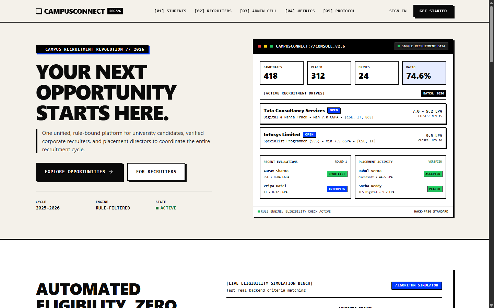
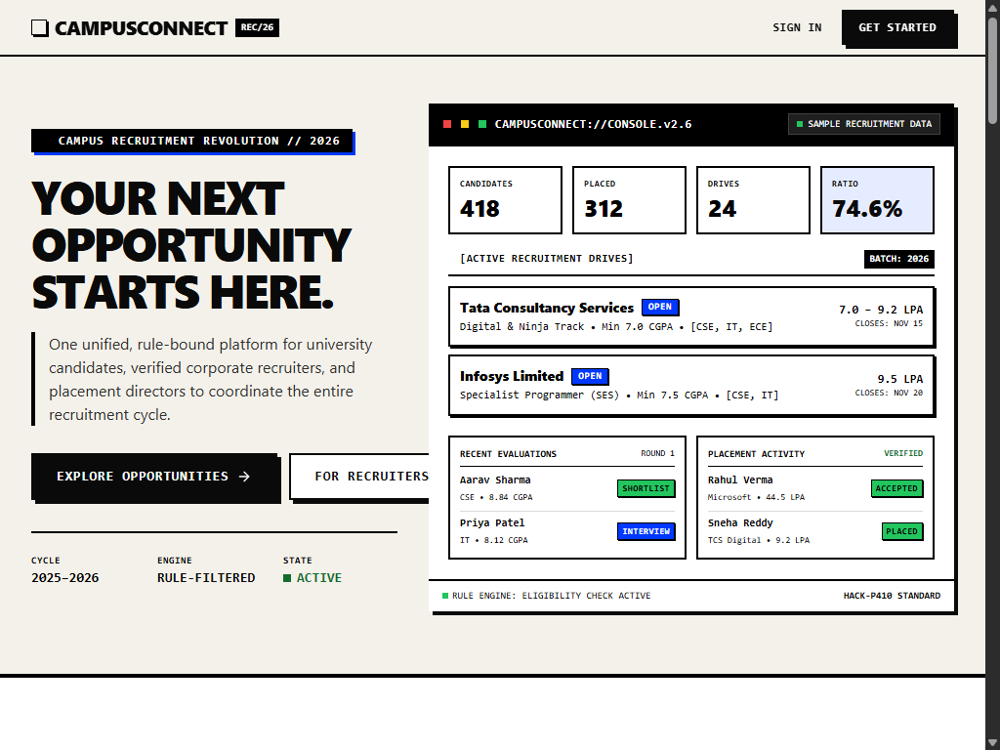
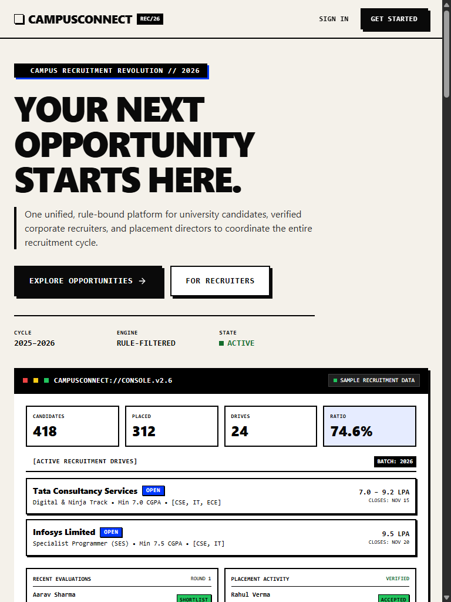
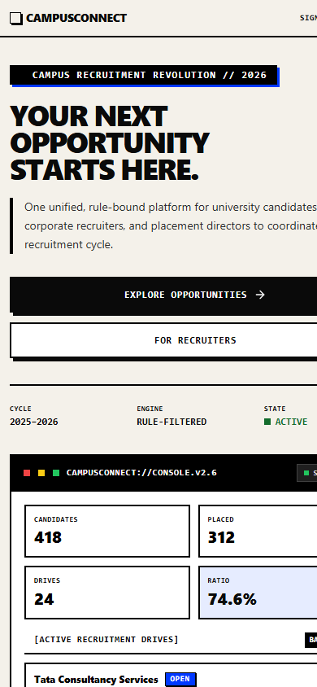

# CAMPUSCONNECT
### One Platform. Every Opportunity.

**A centralized campus recruitment and placement management platform connecting students, recruiters, and placement administrators.**

<p align="center">
  <strong>HACK-P410 | Campus Recruitment Portal</strong><br/>
  Backend Web Development | Student Hackathon Prototype
</p>

---

## Overview

CampusConnect is a full-stack campus recruitment management platform designed to simplify and organize the entire college placement process.

Traditional campus recruitment often depends on spreadsheets, emails, manual eligibility verification, and disconnected communication channels.

CampusConnect brings these activities together in one centralized platform, enabling students to discover opportunities, recruiters to manage hiring activities, and placement administrators to coordinate recruitment operations.

Our goal is simple:

**Make campus recruitment more organized, transparent, and accessible.**

---

## The Problem

Campus placement processes frequently face challenges such as:

- Fragmented student and recruiter information.
- Manual eligibility verification.
- Difficulty tracking job applications.
- Disorganized interview scheduling.
- Scattered communication between stakeholders.
- Limited visibility into placement progress.
- Time-consuming placement reporting.

These inefficiencies make recruitment difficult to coordinate and manage.

## Our Solution

CampusConnect provides a unified digital environment for managing the recruitment lifecycle.

The platform connects three major stakeholders:

| User Role | Responsibilities |
|---|---|
| Students | Manage profiles, explore jobs, check eligibility, apply and track applications. |
| Recruiters | Manage company profiles, publish jobs, review applicants and schedule interviews. |
| Placement Administrators | Manage students, companies, recruitment drives and placement activities. |

---

# Key Features

## 1. Student Portal

- Student registration and authentication.
- Academic profile management.
- University roll number and branch information.
- CGPA and graduation year management.
- Resume upload and management.
- Job discovery and detailed job information.
- Automated eligibility checking.
- Job application submission.
- Application status tracking.
- Interview schedule viewing.
- Placement notifications.

## 2. Recruiter Portal

- Recruiter registration and authentication.
- Company profile management.
- Job posting and management.
- Job eligibility criteria configuration.
- Candidate application review.
- Applicant shortlisting and rejection.
- Interview scheduling.
- Recruitment activity monitoring.

## 3. Placement Administrator Portal

- Student management.
- Recruiter management.
- Company management.
- Recruitment drive management.
- Job and application monitoring.
- Interview management.
- Placement result management.
- Notification management.
- Placement analytics and reporting.

## 4. Eligibility Engine

CampusConnect includes an eligibility checking mechanism that evaluates student information against job requirements.

Criteria can include:

- Minimum CGPA.
- Academic branch.
- Graduation year.
- Required skills, where configured.
- Additional job-specific conditions.

The system provides eligibility results and explanations to help students understand recruitment requirements.

## 5. Authentication and Security

- JWT-based authentication.
- Role-based access control.
- BCrypt password hashing.
- Protected application routes.
- Backend-side request validation.
- Role-specific access restrictions.

---

# Technology Stack

## Frontend

| Technology | Purpose |
|---|---|
| React 18 | User interface |
| TypeScript | Type-safe frontend development |
| JavaScript | Application logic |
| Tailwind CSS | Styling and responsive layouts |
| Vite | Development and production build |
| Axios | REST API communication |

## Backend

| Technology | Purpose |
|---|---|
| Java 21 | Backend programming language |
| Spring Boot 3.2.5 | Backend application framework |
| Spring Security | Application security |
| Spring Data JPA | Database access |
| Hibernate | ORM |
| JWT | Authentication |
| BCrypt | Password hashing |
| Maven | Dependency and build management |

## Database

| Technology | Purpose |
|---|---|
| H2 Database | Development database and persistence |
| Hibernate / JPA | Entity mapping and database operations |

**Note:** The documented development configuration uses file-backed H2. MySQL production support should only be listed as implemented after migration and verification.

## Development and Deployment Tools

- Git and GitHub.
- Google Antigravity.
- Visual Studio Code / IntelliJ IDEA.
- Postman.
- Swagger / OpenAPI.
- Vercel for frontend hosting.
- Docker for backend packaging.

---

# System Architecture

CampusConnect follows a layered full-stack architecture.

```text
             USERS
               |
      +--------+--------+
      |        |        |
   STUDENT  RECRUITER  ADMIN
      |        |        |
      +--------+--------+
               |
       REACT FRONTEND
       TypeScript + Vite
               |
          AXIOS / REST
               |
       SPRING BOOT API
               |
       SPRING SECURITY
          JWT AUTH
               |
       SERVICE LAYER
               |
       REPOSITORY LAYER
        Spring Data JPA
               |
          HIBERNATE
               |
          H2 DATABASE
```

The frontend communicates with the backend through REST APIs.

The backend handles authentication, authorization, business logic, eligibility verification and database operations.

---

# Application Workflow

```text
          STUDENT REGISTRATION
                   |
             LOGIN / JWT
                   |
           STUDENT PROFILE
                   |
            VIEW JOBS
                   |
         CHECK ELIGIBILITY
                   |
             APPLY FOR JOB
                   |
         RECRUITER REVIEWS
                   |
          SHORTLIST CANDIDATE
                   |
         SCHEDULE INTERVIEW
                   |
          SELECTION RESULT
                   |
          PLACEMENT RECORD
```

---

# Project Structure

```text
CampusConnect/
│
├── frontend/
│   ├── public/
│   ├── src/
│   │   ├── components/
│   │   ├── pages/
│   │   ├── layouts/
│   │   ├── services/
│   │   ├── hooks/
│   │   └── App.tsx
│   ├── package.json
│   ├── vite.config.ts
│   └── vercel.json
│
├── backend/
│   ├── src/
│   │   ├── main/
│   │   │   ├── java/
│   │   │   └── resources/
│   │   └── test/
│   ├── pom.xml
│   └── Dockerfile
│
├── database/
│
├── docs/
│   ├── deployment.md
│   ├── api-reference.md
│   ├── presentation.md
│   └── demo-script.md
│
├── screenshots/
│
├── README.md
├── TASKS.md
└── .gitignore
```

*The structure above is representative. Adjust folder names to match the actual repository.*

---

# Getting Started

Follow these steps to run CampusConnect locally.

## Prerequisites

Install:

- Java Development Kit 21.
- Node.js and npm.
- Git.
- Maven or the included Maven wrapper.

## 1. Clone the Repository

```bash
git clone https://github.com/pavankm7523-hue/campusconnect.git
```

```bash
cd campusconnect
```

## 2. Start the Backend

Open a terminal:

```bash
cd backend
```

Build the application:

```bash
mvn clean package
```

Run the Spring Boot application:

```bash
mvn spring-boot:run
```

The backend should run on:

```text
http://localhost:8080
```

## 3. Start the Frontend

Open another terminal:

```bash
cd frontend
```

Install dependencies:

```bash
npm install
```

Start the development server:

```bash
npm run dev
```

The frontend should be available at:

```text
http://localhost:5173
```

## 4. API Documentation

If Swagger is enabled:

```text
http://localhost:8080/swagger-ui/index.html
```

OpenAPI specification:

```text
http://localhost:8080/api-docs
```

---

# Configuration

Create environment-specific configuration using the supplied example files.

Example frontend environment variable:

```env
VITE_API_URL=http://localhost:8080
```

For production, replace this with the actual deployed backend URL.

Never commit passwords, API secrets, JWT signing keys or database credentials.

---

# API Modules

The backend provides REST API functionality for the following modules:

| Module | Functionality |
|---|---|
| Authentication | Registration and login |
| Students | Profile and student information |
| Recruiters | Recruiter and company operations |
| Jobs | Job posting and discovery |
| Eligibility | Eligibility evaluation |
| Applications | Application tracking and management |
| Interviews | Interview scheduling |
| Notifications | User notifications |
| Administration | Placement administration |
| Analytics | Placement statistics |

Refer to the Swagger documentation for the actual implemented endpoint paths and request formats.

---

# User Interface

CampusConnect follows a Modern Digital Brutalist visual identity.

Design characteristics:

- Warm off-white backgrounds.
- Bold black typography.
- Electric cobalt blue accents.
- Sharp rectangular layouts.
- Strong visual borders.
- Hard offset shadows.
- Asymmetric editorial compositions.
- Responsive layouts.

## Screenshots

Add your actual application screenshots to the `screenshots/` folder.

Suggested files:

```text
screenshots/
├── hero_1440_desktop.png
├── hero_1366_laptop.png
├── hero_1024_tablet.png
├── hero_768_tablet.png
├── hero_390_mobile.png
├── desktop_login.png
└── desktop_register.png
```

Display them using:

```markdown







```

---

# Testing

The project includes backend unit tests and frontend build verification.

Areas covered by the test suite include:

- Authentication.
- Eligibility checking.
- Application management.

Run backend tests:

```bash
mvn test
```

Build the frontend:

```bash
npm run build
```

Build the backend:

```bash
mvn clean package
```

Add the latest verified test results before final submission.

---

# Deployment

## Frontend

The React/Vite application can be deployed using Vercel.

Production URL:

https://campusconnect-portal-alpha.vercel.app

## Backend

The Spring Boot backend can be deployed using a compatible Java hosting platform or Docker-based hosting.

## Database

The documented development configuration uses file-backed H2.

For permanent production deployment, configure persistent database storage and verify backup, restart and data-persistence behaviour.

See `docs/deployment.md` for environment-specific instructions.

---

# Future Enhancements

Potential future improvements include:

- AI-powered resume parsing.
- Automated skill matching.
- Smart job recommendations.
- Calendar integration.
- Interview feedback management.
- Offer comparison.
- Advanced placement analytics.
- Email and real-time notifications.
- Enhanced reporting and exports.

These are proposed enhancements and should not be confused with currently implemented features.

---

# Project Information

| Field | Details |
|---|---|
| Project Name | CampusConnect |
| Problem ID | HACK-P410 |
| Category | Job & Recruitment |
| Subject | Backend Web Development |
| Project Type | Student Hackathon Prototype |
| Team Size | 4 Students |

## Team Members

Replace the placeholders with the actual team details.

| Member | Name | Contribution |
|---|---|---|
| Member 1 | YOUR NAME | Frontend Development |
| Member 2 | TEAM MEMBER 2 | Backend Development |
| Member 3 | TEAM MEMBER 3 | Database and Integration |
| Member 4 | TEAM MEMBER 4 | Testing and Documentation |

---

# Project Links

| Resource | Link |
|---|---|
| Live Application | https://campusconnect-portal-alpha.vercel.app |
| GitHub Repository | https://github.com/pavankm7523-hue/campusconnect |
| API Gateway | https://divorce-citizen-special-ext.trycloudflare.com |
| Release Package | https://github.com/pavankm7523-hue/campusconnect/releases/tag/v1.0.0 |

---

# License

This project was developed as a student hackathon prototype.

Add an appropriate open-source license if the team decides to publish the source code under one.

---

<p align="center">
  <strong>CAMPUSCONNECT</strong><br/>
  One Platform. Every Opportunity.
  <br/><br/>
  Built to simplify campus recruitment.
</p>
