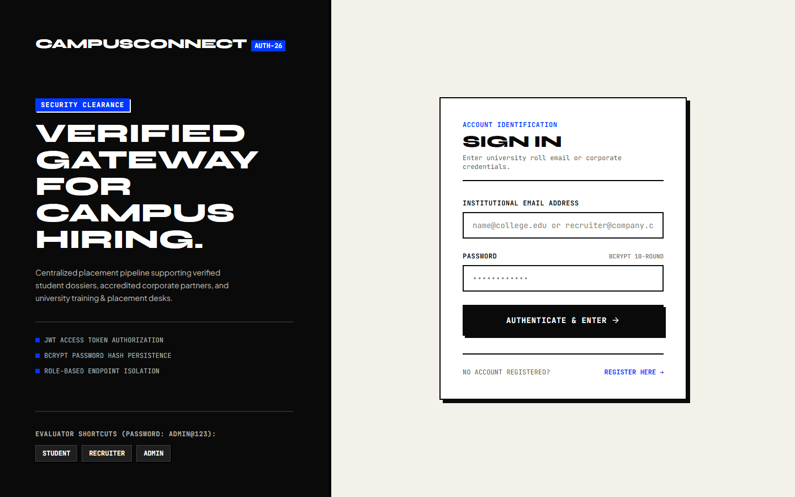
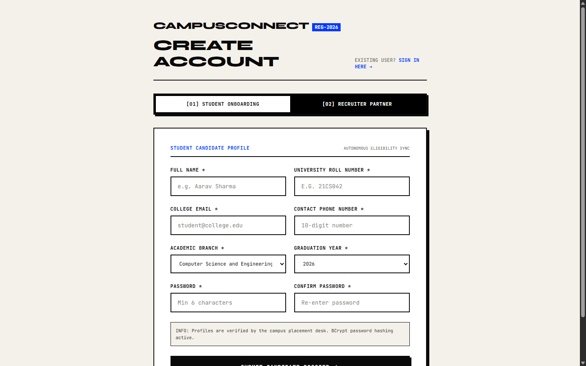
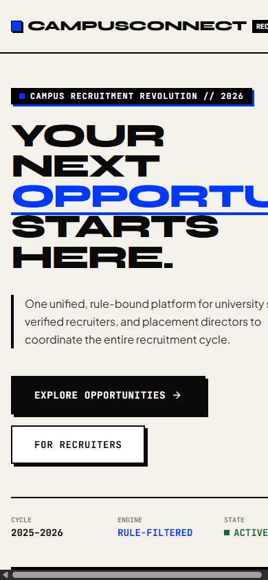

# CampusConnect
### HACK-P410 — Campus Recruitment Management Portal

> **Full-Stack Autonomous Web Platform for University Placement Offices, Corporate Recruiters, and Graduating Candidates.**

[](https://campusconnect-portal-alpha.vercel.app)
[](https://spring.io/projects/spring-boot)
[](https://vitejs.dev/)
[](https://junit.org/junit5/)
[](https://campusconnect-portal-alpha.vercel.app)

---

## 🌐 Live Production Deployment

- **Vercel Frontend URL:** [https://campusconnect-portal-alpha.vercel.app](https://campusconnect-portal-alpha.vercel.app)
- **Vercel Project Dashboard:** [pavankm7523-hues-projects/campusconnect-portal](https://vercel.com/pavankm7523-hues-projects/campusconnect-portal)
- **Local Development URL:** `http://localhost:5173` (Frontend) | `http://localhost:8080` (Backend API)
- **Interactive Swagger UI:** `http://localhost:8080/swagger-ui/index.html`

---

## 📋 Hackathon Project Details

- **Problem Statement ID:** HACK-P410 — Campus Recruitment Portal
- **Subject:** Backend Web Development & Full-Stack Automation
- **Team Size:** 4 Engineering Students
- **Core Mission:** Eliminate disconnected spreadsheets, notice boards, and manual verification errors by consolidating student profiles, company recruitment drives, multi-stage interviews, and institutional analytics into an automated, rule-bound web portal.

---

## 🎨 Visual Identity — Design Direction C (Modern Brutalist)

To permanently eradicate generic AI SaaS aesthetics (purple-to-blue gradients, soulless floating glassmorphism cards, and generic template pill badges), CampusConnect is designed using **Design Direction C — Modern Brutalist**:

- **Color Architecture:**
  - **Canvas Background:** Warm editorial off-white (`#F4F1EA`)
  - **Deep Ink:** Heavy black borders and solid ink text (`#0A0A0A`)
  - **Electric Cobalt:** High-intensity electric blue accents (`#0038FF`)
  - **Surface Charcoal:** Enterprise paneling (`#1F1F1F`)
  - **Signal Yellow:** High-priority status pill highlights (`#FACC15`)
- **Graphic Signatures:**
  - Strict 2px–3px solid black borders on all interactive inputs and containers.
  - Hard drop-shadows with zero blur (`shadow-[4px_4px_0px_#0A0A0A]`).
  - Active button states with mechanical physical press-down feedback (`translate-x-0.5 translate-y-0.5`).
- **Typography Hierarchy:**
  - Display & Brand: `Syne` and `Space Grotesk` (all-caps, ultra-bold, tight tracking).
  - Data & Metrics: `JetBrains Mono` for audit logs, roll numbers, CTC figures, and timestamps.
  - Body & Reading: `Plus Jakarta Sans` for maximum cross-platform legibility.

---

## 📸 Application Screenshots

| Homepage (Modern Brutalist Hero) | Login Security Gateway |
|---|---|
|  |  |

| Candidate Registration & Dual Tabs | Mobile Responsive Experience (390px) |
|---|---|
|  |  |

---

## ⚡ Key System Modules

### 🎓 1. Student Candidate Portal
- **Academic Dossier:** Profile manager cataloging University Roll/USN, Branch, verified CGPA (0.00–10.00), passing out year, and skills tags.
- **Verified Resume Storage:** Upload and manage PDF resumes with size validation and secure path download.
- **Drive Discovery & Filtering:** Live corporate directory with keyword search, contract type filter, and branch filter.
- **Dual-Gate Eligibility Audit:** Instant visual breakdown of satisfied vs deficient benchmarks (CGPA cutoff, branch eligibility, batch year, skill prerequisites).
- **Candidacy Tracking:** One-click application filing, real-time application stage monitoring (`APPLIED`, `SHORTLISTED`, `SELECTED`, `REJECTED`), and candidate withdrawal capabilities.
- **Interview Roster:** Calendar schedule for technical assessments, venue links, and interviewer feedback.
- **Placement Dossier:** Official verified placement letter card with CTC package and reporting date.
- **Dispatch Center:** Unread announcement counter with click-to-acknowledge functionality.

### 🏢 2. Corporate Recruiter Portal
- **Enterprise Profile:** Verified hiring desk linked to partner corporation with operational credentials.
- **Drive Requisition Engine:** Full job posting wizard with granular constraints (minimum CGPA decimal threshold, multi-select branch whitelist, graduation years multi-toggle, and required technical skills).
- **Candidate Screening Desk:** Filter applicants by status, inspect student academic stats, and review PDF resumes.
- **Evaluation Pipeline:** One-click candidate shortlisting and rejection with structured feedback justification.
- **Assessment Scheduler:** Set interview timings, round types (Technical, Managerial, HR), and venue/video conference URLs.
- **Outcome Recorder:** Update candidate interview verdicts (`PASSED`, `FAILED`, `PENDING`) with panel evaluation notes.

### 🏛️ 3. Training & Placement (T&P) Administration
- **Institutional Governance Dashboard:** Live metric counters (Total Candidates, Partner Firms, Active Drives, Filed Candidacies, Placed Students, Institutional Placement %).
- **Discipline Distribution:** Real-time branch-wise placement breakdown meters computed directly from the relational database.
- **Student Registry:** Full searchable candidate roster with one-click institutional CSV export for accreditation audits.
- **Recruiter Clearance Desk:** Approve or restrict corporate recruiter portal accounts before listings go live.
- **Enterprise Partner Directory:** Complete CRUD management for accredited companies, logos, websites, and recruiter associations.
- **Recruitment Drive Orchestrator:** Schedule on-campus seasons, activate multi-day hiring tracks, and track completion.
- **Governance Overrides:** Ability to update application pipeline statuses and arbitrate student placement outcomes.
- **Broadcast Communique Desk:** Targeted announcements dispatched to all users, student cohorts, or corporate partners.

### 🧠 4. Server-Side Eligibility Engine
Every job application is validated by `EligibilityService.java` against 4 independent criteria:
1. **Academic CGPA:** Real-time check (`student.cgpa >= job.minCgpa`).
2. **Disciplinary Whitelist:** Student branch validated against recruiter's eligible branch set (`CSE`, `IT`, `ECE`, `EEE`, `ME`, `CE`, `AIDS`, `AIML`, `DS`).
3. **Batch Matching:** Graduation year verification against target passing out batches.
4. **Competency Overlap:** Analysis of candidate technical skill tags against job prerequisites.

---

## 🛠️ Technology Stack

| Layer | Component | Implementation |
|---|---|---|
| **Frontend Framework** | React 18 & TypeScript | Vite 5 build tool, client-side routing with React Router v6 |
| **Styling & Design** | Tailwind CSS 3.4 | Modern Brutalist design system, custom typography, hard drop shadows |
| **Data Visualization** | Recharts | Responsive bar charts, pie charts, and velocity line charts |
| **Icons & Notifications** | Lucide React & React Hot Toast | High-contrast brutalist icon set and deduplicated toast messaging |
| **HTTP & Networking** | Axios | Relative proxying, JWT request interceptor, unified error extractor |
| **Backend Framework** | Java 17 & Spring Boot 3.2.5 | Spring Web, Spring Security, Spring Data JPA, Hibernate ORM |
| **Authentication & Tokens** | JWT (jjwt 0.12.3) & BCrypt | Cryptographically signed HS512 tokens with role claims, 10-round BCrypt |
| **Database** | MySQL 8.0 / H2 | 10 normalized relational tables, foreign key cascades, composite indexes |
| **API Documentation** | Springdoc OpenAPI 2.3.0 | Interactive Swagger UI at `/swagger-ui/index.html` |
| **Build & Testing** | Maven 3.8+ & JUnit 5 | 15 JUnit and Mockito unit tests (100% pass rate) |

---

## 🧪 Automated Unit Test Suite (15/15 Passing)

The backend test suite verifies core business logic across authentication, eligibility, and application workflows:

```bash
mvn test
```

```
[INFO] -------------------------------------------------------
[INFO]  T E S T S
[INFO] -------------------------------------------------------
[INFO] Running com.campusconnect.ApplicationServiceTest
[INFO] Tests run: 5, Failures: 0, Errors: 0, Skipped: 0, Time elapsed: 1.114 s
[INFO] Running com.campusconnect.AuthServiceTest
[INFO] Tests run: 5, Failures: 0, Errors: 0, Skipped: 0, Time elapsed: 0.252 s
[INFO] Running com.campusconnect.EligibilityServiceTest
[INFO] Tests run: 5, Failures: 0, Errors: 0, Skipped: 0, Time elapsed: 0.019 s
[INFO] 
[INFO] Results:
[INFO] Tests run: 15, Failures: 0, Errors: 0, Skipped: 0
[INFO] ------------------------------------------------------------------------
[INFO] BUILD SUCCESS
```

---

## 🔑 Evaluator Demo Credentials

Pre-seeded database accounts available for evaluation:

| Role | Email Address | Password | Permissions & Dashboard |
|---|---|---|---|
| **T&P Administrator** | `admin@campusconnect.edu` | `Admin@123` | Master governance, partner approval, analytics, CSV export |
| **Corporate Recruiter** | `recruiter1@tcs.com` | `Admin@123` | Post openings, candidate review, schedule interviews |
| **Student Candidate** | `student1@college.edu` | `Admin@123` | Profile management, browse drives, 1-click apply, track status |

---

## 🚀 Quick Start & Installation

### Option A: One-Click Local Run (Windows)
Double-click `run-local.bat` in the root folder, or execute:
```cmd
run-local.bat
```
To cleanly stop all background services:
```cmd
stop-local.bat
```

### Option B: Manual Step-by-Step Setup

#### 1. Start Backend (Spring Boot 3.2.5)
```bash
cd CampusConnect/backend
./mvnw clean package -DskipTests
java -jar target/campusconnect-backend-1.0.0.jar
# Backend initializes on http://localhost:8080 with auto-seeded demo data
```

#### 2. Start Frontend (React + Vite)
```bash
cd CampusConnect/frontend
npm install
npm run dev
# Frontend runs on http://localhost:5173
```

#### 3. Build for Production
```bash
cd CampusConnect/frontend
npm run build
# Compiles verified production bundles to dist/
```

---

## 📂 Project Repository Structure

```
CampusConnect/
├── frontend/
│   ├── src/
│   │   ├── pages/
│   │   │   ├── public/LandingPage.tsx      # Modern Brutalist Hero & Eligibility Tester
│   │   │   ├── auth/LoginPage.tsx          # High-contrast Authentication Gateway
│   │   │   ├── auth/RegisterPage.tsx       # Student & Recruiter Onboarding Tabs
│   │   │   ├── student/                    # Student Portal (Dashboard, Jobs, Applications, Profile)
│   │   │   ├── recruiter/                  # Recruiter Portal (Jobs, Create Job, Applicants, Interviews)
│   │   │   └── admin/                      # Admin Portal (Audit, Students, Recruiters, Analytics)
│   │   ├── components/                     # Brutalist StatCards, Badges, Spinners
│   │   ├── services/api.ts                 # Axios networking & toast deduplication
│   │   └── context/AuthContext.tsx         # JWT state management
│   ├── tailwind.config.js                  # Brutalist design tokens & font bindings
│   └── package.json
├── backend/
│   ├── src/main/java/com/campusconnect/
│   │   ├── entity/                         # 10 Normalized JPA Entities
│   │   ├── controller/                     # REST API Controllers (/api/*)
│   │   ├── service/                        # Business Logic & Eligibility Engine
│   │   ├── repository/                     # Spring Data JPA Repositories
│   │   ├── security/                       # JWT Filter, Authentication Manager
│   │   └── config/                         # OpenAPI Swagger & CORS Config
│   ├── src/test/java/com/campusconnect/    # 15 Unit & Mockito Tests
│   └── pom.xml                             # Spring Boot 3.2.5 dependencies
├── database/
│   ├── schema.sql                          # Full DDL (10 relational tables)
│   └── seed.sql                            # Production seed data
├── docs/
│   ├── presentation.md                     # 10-Slide Hackathon PPT Outline
│   ├── demo-script.md                      # 5-Minute Video Walkthrough Script
│   ├── architecture.md                     # Detailed Three-Tier System Architecture
│   ├── er-diagram.md                       # Relational Entity-Relationship Guide
│   └── deployment.md                       # Vercel & Cloud Backend Blueprint
├── screenshots/                            # Desktop & Mobile UI Captures
├── TASKS.md                                # Phase-by-phase development checklist (100% complete)
├── run-local.bat                           # 1-Click Windows execution script
└── stop-local.bat                          # 1-Click service termination script
```

---

## 🏆 Hackathon Submission Deliverables

- **Slide Deck Outline:** [`docs/presentation.md`](docs/presentation.md) (10 structured presentation slides)
- **Demo Video Script:** [`docs/demo-script.md`](docs/demo-script.md) (Time-coded 5-minute evaluator demonstration walkthrough)
- **API Specification:** Interactive Swagger UI at `http://localhost:8080/swagger-ui/index.html` and [`docs/api-reference.md`](docs/api-reference.md)
- **Postman API Test Collection:** [`tests/CampusConnect.postman_collection.json`](tests/CampusConnect.postman_collection.json)

---

## 📜 License & Acknowledgments
Developed by Team 4 for **HACK-P410 — Campus Recruitment Portal**. Built with educational rigor, clean architecture principles, and zero AI aesthetic compromises.
